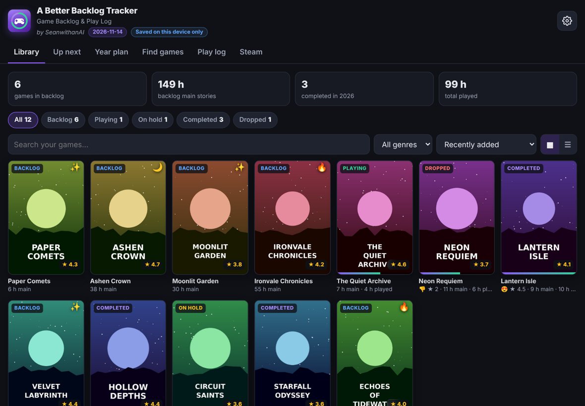
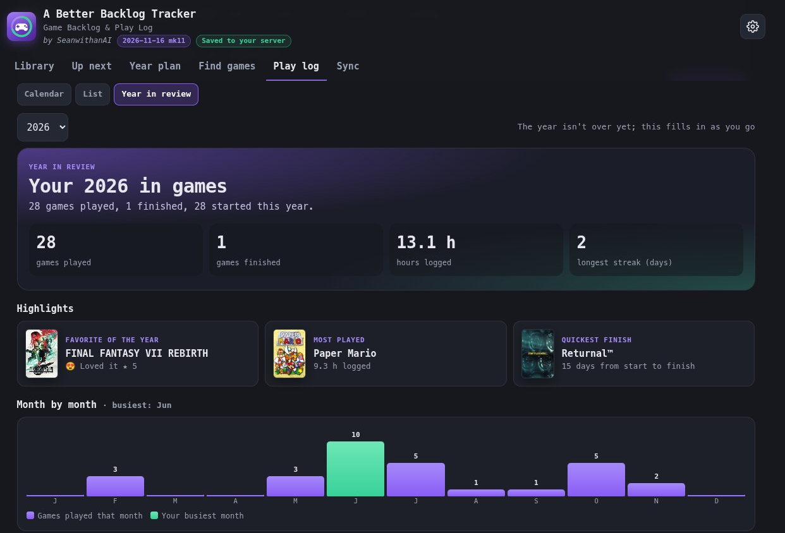

<div align="center">


# A Better Backlog Tracker

**Game Backlog & Play Log: what to play next, how long it takes, and your year in games**


**[▶ Open it online](https://seanwithanai.github.io/A-Better-Backlog-Tracker/)** · nothing to install · your data stays on your device

*by SeanwithanAI*

</div>



---

## Overview

A Better Backlog Tracker keeps your game backlog, your play log and your reviews in one place. It helps you decide what to play next, plans a year of games around the time you actually have, and wraps each year up with a recap. It's all in one HTML file, with nothing to install and no sign-up.

## Features

- **Find games before you add them.** Search the free **RAWG** game database and see screenshots, player ratings, Metacritic score, genres, platforms, developer and a description first.
- **Cover-art library.** Sharp box-art tiles (Steam box art when available) showing status, how excited you are (🔥 ✨ 🌙), the player rating, main-story time, hours played and a progress bar. Switch to detail cards any time. Filter by status or genre, and sort by rating, length, time played, release date, or excitement (most → least or least → most).
- **Real box art.** With a free SteamGridDB key, the tracker fills in proper box art (not screenshots). It's automatic in PageVault or with a CORS proxy; opened on its own, use **Browse SteamGridDB** on a game and **Upload cover**. Steam games also get Steam's own cover art without any key. It only fills covers you haven't set yourself: paste a SteamGridDB link or upload your own and it's left alone; clear it and automatic art comes back.
- **Upload your own pictures.** Add your own cover (portrait 600 × 900, 2:3) and screenshots (landscape 1920 × 1080, 16:9) to any game. In PageVault they're saved on your server.
- **HowLongToBeat times.** Every game links to HowLongToBeat and keeps its main-story hours. Estimated times are marked **≈** until you confirm them.
- **How excited are you?** *🔥 Can't wait*, *✨ Interested* or *🌙 Someday*, each explained, so the backlog sorts itself.
- **Up next.** One clear pick for what to play next, plus backups, each with the reasons (*"Heavy on story, like Disco Elysium, which you enjoyed"*). Choose how long a game you want, from short to 30 h+. **Not now** hides a pick for 3 days.
- **It learns what you like.** After you finish a game, *How was it?* asks how you felt (😍 🙂 😐 👎), what worked (story, combat, music, challenge…), what didn't, and whether you want more like it. Every review changes the picks and the **Your taste so far** summary.
- **Other players' opinions.** RAWG player ratings (Exceptional → Skip), the critic score, recent posts from the game's subreddit, and links to Steam, Metacritic, RAWG and Backloggd reviews.
- **Year plan.** Set a goal (*finish 20 games*) and how many hours a week you can play. The plan fills the year month by month from your backlog. Mark a game **📌 must play** and the plan makes room, telling you what it moved out to stay within your hours. If the goal doesn't fit, it shows how many hours a week you'd need.
- **Play log with start and finish dates.** Log when you started and finished each game, with optional hours and notes. See a **calendar** of what you played each day, and a counter of games played and finished this year, with your goal.
- **Year in review.** Games played and finished, hours, longest streak, favorite, most played, quickest finish, longest journey, month by month, and every game's start-to-finish timeline. A banner announces it each December.
- **Import your backlog.** Paste a list of games, or import a game-list file (for example, a Backloggd backlog). Games you already have are skipped, and RAWG can fill in covers and ratings afterwards.
- **Retro handheld playtime (optional).** Cocoon's backups include every play session. Make a backup in Cocoon and import it in the **Sync** tab. Only new sessions are added, so importing the same backup again is safe.
- **Steam playtime (optional).** Add your Steam Web API key and SteamID64. In PageVault, your playtime syncs automatically every time you open the tracker (at most every 30 minutes): new hours go into your play log, and games you've started move to Playing. Opened on its own, add a CORS proxy and it syncs automatically the same way, or use **Sync now** with the two-step copy-and-paste.
- **Day or Dark.** Choose Day, Dark or Auto (follows your device) in Settings.
- **Backup and restore,** with a reminder when you haven't backed up in a week (outside PageVault).
- **Download app + data.** In **Settings**, one click downloads a .zip with this version of the app, a backup of your data, and a short note on how to restore it. Open the HTML anywhere and restore the backup to pick up where you left off. In PageVault it's the exact file that's installed.

## Screenshots

| Up next | Year in review |
|---|---|
|  |  |

| Year plan |
|---|
|  |

<sub>Screenshots use made-up games and example data.</sub>

## Getting started

1. Open `A-Better-Backlog-Tracker-<date>-<mk>.html` in any modern browser, or open it from **PageVault**.
2. For game search, get a free API key at [rawg.io/apidocs](https://rawg.io/apidocs) and paste it in **Find games** (or **Settings**).
3. Add games from **Find games**, use **Import a list**, or import a game-list file from **Settings → Import backup**.
4. Mark how excited you are about each game, and check **Up next** when you can't decide.
5. When you start or finish a game, log it in **Play log** and answer *How was it?*

Online lookups (RAWG, Steam, cover images) use free public services. Everything else works offline.

## Opening the file on your devices

**Easiest: the web link.** Open **[seanwithanai.github.io/A-Better-Backlog-Tracker](https://seanwithanai.github.io/A-Better-Backlog-Tracker/)** on any phone, tablet or computer. It's this same app, served by GitHub, and it always has the newest version. Nothing is sent anywhere: your data is saved in that browser on that device, just like the downloaded file. On iPhone or iPad, open it in Safari, tap **Share** (on iOS 26 and later, tap **•••** first), then **Add to Home Screen** to keep it like an app. On Android, use Chrome's **⋮ → Add to Home screen**.

Prefer to keep your own copy of the file? The steps below cover that.

The app is one self-contained `.html` file: no install, no account, nothing else to download. Download `A-Better-Backlog-Tracker-<date>.html`: open it in the file list above, then use the **Download raw file** button (↓) at the top right of the file view.

**Desktop (Windows, macOS, Linux)**
1. Download the file and move it somewhere permanent, like Documents.
2. Double-click it. It opens in your default browser (Chrome, Edge, Firefox, Safari and Brave all work).
3. Bookmark it, and always open it the same way: same file, same place, same browser. Your data is saved in that browser for that file, so a copy in another folder or another browser starts empty.

**iPhone and iPad**
**Because of iOS, an HTML file saved on your iPhone or iPad can't be opened in Safari.** iOS doesn't offer Safari as a way to open it, and tapping the file in the Files app only shows a preview with the buttons turned off. Use one of these instead:
- **The web link (recommended).** See above.
- **PageVault.** Open the app's PageVault link in **Safari**, then tap **Share** (on iOS 26, tap **•••** first, then **Share**). Scroll down the list and tap **Add to Home Screen**. If it isn't there, tap **Edit Actions** at the bottom of the list and add it. It then opens like a regular app, and your data is saved on your server and syncs with your other devices.
- **Microsoft Edge (may work).** Save the file to the Files app, then try opening it with Edge (in Files, open the file, tap **Share** and choose **Edge**). Keep backups: data saved this way can be lost if Edge clears its storage.

**Android**
1. Download the file in Chrome.
2. Open it from Chrome: **⋮ → Downloads** and tap the file (or from the Files app, **Open with → Chrome**).
3. Open it from Chrome's Downloads each time. A home-screen shortcut to a downloaded file may stop working after Chrome restarts.
4. Turn on backups (the app reminds you every 7 days), or use **PageVault** and **⋮ → Add to Home screen** so your data lives on your server instead.

**Moving to another device:** download a backup in the app, open the same version on the new device, and restore the backup there. With PageVault there's nothing to move.

## Getting a proxy (only for the file on its own)

Steam and SteamGridDB don't answer web pages directly. In PageVault this is handled for you. Opened as a file, the tracker can use a small proxy for automatic Steam sync and box art. These steps are also in the app, under **Sync → How to get a proxy**.

**Free option: your own Cloudflare Worker (about 5 minutes)**
1. Sign up for free at [cloudflare.com](https://dash.cloudflare.com/sign-up).
2. Go to **Workers & Pages**, tap **Create**, start from the **Hello World** template, and tap **Deploy**.
3. Tap **Edit code**, replace everything with the code below, then tap **Deploy**.
4. Copy your Worker's address (it ends in `workers.dev`), add `/?url={url}` to the end, and paste it in **Sync → CORS proxy**. Example: `https://backlog-proxy.yourname.workers.dev/?url={url}`

```js
// A Better Backlog Tracker: tiny proxy for Steam and SteamGridDB (Cloudflare Worker)
export default {
  async fetch(req) {
    const cors = {'Access-Control-Allow-Origin': '*', 'Access-Control-Allow-Headers': 'Authorization', 'Access-Control-Allow-Methods': 'GET, OPTIONS'};
    if (req.method === 'OPTIONS') return new Response(null, {headers: cors});
    const url = new URL(req.url).searchParams.get('url') || '';
    if (!/^https:\/\/(api\.steampowered\.com|www\.steamgriddb\.com)\//.test(url)) return new Response('Only Steam and SteamGridDB addresses are allowed.', {status: 403, headers: cors});
    const auth = req.headers.get('Authorization');
    const r = await fetch(url, {headers: auth ? {Authorization: auth} : {}});
    const headers = new Headers(r.headers);
    for (const [k, v] of Object.entries(cors)) headers.set(k, v);
    return new Response(r.body, {status: r.status, headers});
  }
};
```

This Worker only passes along Steam and SteamGridDB requests, so nobody can use it as a general proxy. Don't use a public proxy you find online: your Steam and SteamGridDB keys would pass through someone else's server.

**Already run a server?** Any CORS proxy works, for example [cors-anywhere](https://github.com/Rob--W/cors-anywhere). Enter its address, like `http://your-server:8080/`.

## Where your data is stored

| Opened from… | Saved to | Badge shown under the app's name |
|---|---|---|
| **PageVault** | Your own server only, separately for each signed-in person. Nothing is kept in the browser. No backup reminders. | *Saved to your server* |
| **A local file** | This browser only. Use **Settings → Back up** to keep a copy; a reminder appears after 7 days without one. | *Saved on this device only* |

Backups include your API keys. Moving between the two: back up on one side and **Import backup** on the other.

## Versioning

Only the newest release is kept here: `A-Better-Backlog-Tracker-2026-11-16-mk5.html`. Each new release replaces it, and `docs/index.html` (what the web link opens) is updated to match. Your data isn't stored in the file, so moving to a new release keeps it (if you use the downloaded file, open the new one the same way as before, in the same browser, and download a backup first to be safe).

Releases are named with their date. The first release of a day is just the date; later releases that same day add `mk1`, `mk2`, `mk3`… (the count starts over each day). The version is also shown inside the app.

| Version | Notes |
|---|---|
| **2026-11-16 mk5** | Current release. |

<div align="center"><sub>A Better Backlog Tracker · Game Backlog & Play Log · by SeanwithanAI</sub></div>
