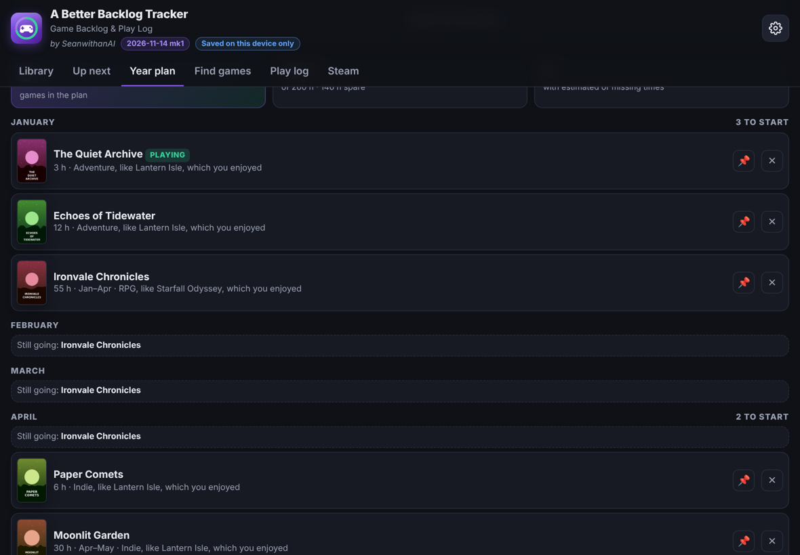
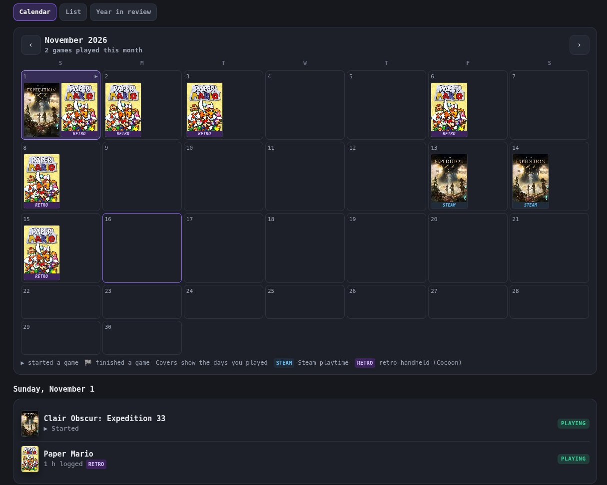

<div align="center">


# A Better Backlog Tracker

**Game Backlog & Play Log: what to play next, how long it takes, and your year in games**


**[▶ Open it online](https://seanwithanai.github.io/A-Better-Backlog-Tracker/)** · nothing to install · your data stays on your device

*by SeanwithanAI*

</div>


---

## Overview

A Better Backlog Tracker keeps your game backlog, your play log and your reviews in one place. It helps you decide what to play next, plans a year of games around the time you actually have, and wraps each year up with a recap. It's all in one HTML file, with nothing to install and no sign-up.

## Features

- **Find games before you add them.** Search the free **RAWG** game database and see screenshots, player ratings, Metacritic score, genres, platforms, developer and a description first.
- **Cover-art library.** Sharp box-art tiles (Steam box art when available) showing status, how excited you are (🔥 ✨ 🌙), the player rating, main-story time, hours played and a progress bar. Switch to detail cards any time. Filter by status or genre, and sort by rating, length, time played, release date, or excitement (most → least or least → most).
- **Real box art.** With a free SteamGridDB key, the tracker fills in proper box art (not screenshots). It's automatic in PageVault or with a CORS proxy; opened on its own, use **Browse SteamGridDB** on a game and **Upload cover**. Steam games also get Steam's own cover art without any key. It only fills covers you haven't set yourself: paste a SteamGridDB link or upload your own and it's left alone; clear it and automatic art comes back.
- **Upload your own pictures.** Add your own cover (portrait 600 × 900, 2:3) and screenshots (landscape 1920 × 1080, 16:9) to any game. In PageVault they're saved on your server.
- **HowLongToBeat times.** Every game links to HowLongToBeat and keeps its main-story hours. Estimated times are marked **≈** until you confirm them.
- **How excited are you?** *🔥 Can't wait*, *✨ Interested* or *🌙 Someday*, each explained, so the backlog sorts itself.
- **Up next.** One clear pick for what to play next, plus backups, each with the reasons (*"Heavy on story, like Disco Elysium, which you enjoyed"*). Choose how long a game you want, from short to 30 h+. **Not now** hides a pick for 3 days.
- **It learns what you like.** After you finish a game, *How was it?* asks how you felt (😍 🙂 😐 👎), what worked (story, combat, music, challenge…), what didn't, and whether you want more like it. Every review changes the picks and the **Your taste so far** summary.
- **Other players' opinions.** RAWG player ratings (Exceptional → Skip), the critic score, recent posts from the game's subreddit, and links to Steam, Metacritic, RAWG and Backloggd reviews.
- **Year plan.** Set a goal (*finish 20 games*) and how many hours a week you can play. The plan fills the year month by month from your backlog. Mark a game **📌 must play** and the plan makes room, telling you what it moved out to stay within your hours. If the goal doesn't fit, it shows how many hours a week you'd need. **🔥 Can't-wait** games get as many spots as your goal and hours allow, newest releases first, so the day-one games you're waiting on make it in; any that don't fit are listed. Brave enough? Tap **Ready to be depressed?** to see the year you'll beat your whole backlog at the rate you play now.
- **Play log with start and finish dates.** Log when you started and finished each game, with optional hours and notes. See a **calendar** of what you played each day, and a counter of games played and finished this year, with your goal.
- **Year in review.** Games played and finished, hours, longest streak, favorite, most played, quickest finish, longest journey, month by month, and every game's start-to-finish timeline. A banner announces it each December.
- **Import from Backloggd.** Bring your whole Backloggd library over with your ratings, start and finish dates, hours, play sessions and reviews; your ratings teach **Up next** what you like right away. Your Backloggd wishlist can come along as 🌙 Someday. See [Importing from Backloggd](#importing-from-backloggd).
- **Import any list.** Paste one game per line, or import a game-list file. Games you already have are skipped, and RAWG can fill in covers and ratings afterwards.
- **Retro handheld playtime (optional).** Cocoon's backups include every play session. Make a backup in Cocoon and import it in the **Sync** tab. Only new sessions are added, so importing the same backup again is safe.
- **Steam playtime (optional).** Add your Steam Web API key and SteamID64. In PageVault, your playtime syncs automatically every time you open the tracker (at most every 30 minutes): new hours go into your play log, and games you've started move to Playing. Opened on its own, add a CORS proxy and it syncs automatically the same way, or use **Sync now** with the two-step copy-and-paste.
- **Day or Dark.** Choose Day, Dark or Auto (follows your device) in Settings.
- **Backup and restore,** with a reminder when you haven't backed up in a week (outside PageVault). With uploaded pictures the backup is a .zip that includes them, and even a library of hundreds of games with custom covers backs up in seconds, including on phones.
- **Download app + data.** In **Settings**, one click downloads a .zip with this version of the app, a backup of your data, and a short note on how to restore it. Open the HTML anywhere and restore the backup to pick up where you left off. In PageVault it's the exact file that's installed.

## Importing from Backloggd

Backloggd has no export of its own, so a free, open-source browser extension adds one.

1. Install the [Backloggd+ extension](https://addons.mozilla.org/firefox/addon/backloggd-plus/) (Firefox).
2. Sign in on [backloggd.com](https://backloggd.com) and open **Settings**. Find the **Data** section the extension adds.
3. Export as **JSON**. It includes your individual play sessions; CSV works too, without them. Big libraries can take a minute.
4. In the tracker, go to **Find games → Import from Backloggd or a list**, click **Choose a file…** and pick the downloaded file.

**What comes over:** each game's status, your rating (Backloggd's 10-point scale becomes 0.5–5 stars), start and finish dates, hours, play sessions (JSON) and review. Games you marked **Played** come in as **Completed**, so change any you didn't finish. Ratings and ♥ likes teach **Up next** what you enjoy. Games already in your library are skipped, so importing again is safe.

## Screenshots

| Up next | Year plan |
|---|---|
|  |  |

| Year in review | Play log calendar |
|---|---|
|  |  |

<sub>Screenshots from a real library.</sub>

## Getting started

1. Open `A-Better-Backlog-Tracker-<date>-<mk>.html` in any modern browser, or open it from **PageVault**.
2. For game search, get a free API key at [rawg.io/apidocs](https://rawg.io/apidocs) and paste it in **Find games** (or **Settings**).
3. Add games from **Find games**, use **Import from Backloggd or a list**, or import a game-list file from **Settings → Import backup**.
4. Mark how excited you are about each game, and check **Up next** when you can't decide.
5. When you start or finish a game, log it in **Play log** and answer *How was it?*

No account and no tracking. The app only goes online for the lookups you use: game search and details from [RAWG](https://rawg.io), and, if you turn them on, Steam playtime and SteamGridDB box art. Everything else works offline. Game data and images from [RAWG](https://rawg.io).

## Opening the file on your devices

**Easiest: the web link.** Open **[seanwithanai.github.io/A-Better-Backlog-Tracker](https://seanwithanai.github.io/A-Better-Backlog-Tracker/)** on any phone, tablet or computer. It's this same app, served by GitHub, and it always has the newest version. Your data is saved in that browser on that device, just like the downloaded file. There's no account and no tracking. On iPhone or iPad, open it in Safari, tap **Share** (on iOS 26 and later, tap **•••** first), then **Add to Home Screen** to keep it like an app. **Do this on iPhone and iPad:** Safari can erase a website's saved data if you go 7 days of using Safari without opening it, but it keeps the data of pages added to the Home Screen. The app reminds you once. On Android, use Chrome's **⋮ → Add to Home screen**.

Prefer to keep your own copy of the file? The steps below cover that.

The app is one self-contained `.html` file: no install, no account, nothing else to download. Download `A-Better-Backlog-Tracker-<date>.html`: open it in the file list above, then use the **Download raw file** button (↓) at the top right of the file view.

**Desktop (Windows, macOS, Linux)**
1. Download the file and move it somewhere permanent, like Documents.
2. Double-click it. It opens in your default browser (Chrome, Edge, Firefox, Safari and Brave all work).
3. Bookmark it, and always open it the same way: same file, same place, same browser. Your data is saved in that browser for that file, so a copy in another folder or another browser starts empty.

**iPhone and iPad**
**Because of iOS, an HTML file saved on your iPhone or iPad can't be opened in Safari.** iOS doesn't offer Safari as a way to open it, and tapping the file in the Files app only shows a preview with the buttons turned off. Use one of these instead:
- **The web link (recommended).** See above.
- **PageVault.** Open the app's PageVault link in **Safari**, then tap **Share** (on iOS 26, tap **•••** first, then **Share**). Scroll down the list and tap **Add to Home Screen**. If it isn't there, tap **Edit Actions** at the bottom of the list and add it. It then opens like a regular app, and your data is saved on your server and syncs with your other devices.
- **Microsoft Edge (may work).** Save the file to the Files app, then try opening it with Edge (in Files, open the file, tap **Share** and choose **Edge**). Keep backups: data saved this way can be lost if Edge clears its storage.

**Android**
1. Download the file in Chrome.
2. Open it from Chrome: **⋮ → Downloads** and tap the file (or from the Files app, **Open with → Chrome**).
3. Open it from Chrome's Downloads each time. A home-screen shortcut to a downloaded file may stop working after Chrome restarts.
4. Turn on backups (the app reminds you every 7 days), or use **PageVault** and **⋮ → Add to Home screen** so your data lives on your server instead.

**Moving to another device:** download a backup in the app, open the same version on the new device, and restore the backup there. With PageVault there's nothing to move.

## Getting a proxy (only for the file on its own)

Steam and SteamGridDB don't answer web pages directly. In PageVault this is handled for you. Opened as a file, the tracker can use a small proxy for automatic Steam sync and box art. These steps are also in the app, under **Sync → How to get a proxy**.

**Free option: your own Cloudflare Worker (about 5 minutes)**
1. Sign up for free at [cloudflare.com](https://dash.cloudflare.com/sign-up).
2. Go to **Workers & Pages**, tap **Create**, start from the **Hello World** template, and tap **Deploy**.
3. Tap **Edit code**, replace everything with the code below, then tap **Deploy**.
4. Copy your Worker's address (it ends in `workers.dev`), add `/?url={url}` to the end, and paste it in **Sync → CORS proxy**. Example: `https://backlog-proxy.yourname.workers.dev/?url={url}`

```js
// A Better Backlog Tracker: tiny proxy for Steam and SteamGridDB (Cloudflare Worker)
export default {
  async fetch(req) {
    const cors = {'Access-Control-Allow-Origin': '*', 'Access-Control-Allow-Headers': 'Authorization', 'Access-Control-Allow-Methods': 'GET, OPTIONS'};
    if (req.method === 'OPTIONS') return new Response(null, {headers: cors});
    const url = new URL(req.url).searchParams.get('url') || '';
    if (!/^https:\/\/(api\.steampowered\.com|www\.steamgriddb\.com)\//.test(url)) return new Response('Only Steam and SteamGridDB addresses are allowed.', {status: 403, headers: cors});
    const auth = req.headers.get('Authorization');
    const r = await fetch(url, {headers: auth ? {Authorization: auth} : {}});
    const headers = new Headers(r.headers);
    for (const [k, v] of Object.entries(cors)) headers.set(k, v);
    return new Response(r.body, {status: r.status, headers});
  }
};
```

This Worker only passes along Steam and SteamGridDB requests, so nobody can use it as a general proxy. Don't use a public proxy you find online: your Steam and SteamGridDB keys would pass through someone else's server.

**Already run a server?** Any CORS proxy works, for example [cors-anywhere](https://github.com/Rob--W/cors-anywhere). Enter its address, like `http://your-server:8080/`.

## Where your data is stored

| Opened from… | Saved to | Badge shown under the app's name |
|---|---|---|
| **PageVault** | Your own server only, separately for each signed-in person. Nothing is kept in the browser. No backup reminders. | *Saved to your server* |
| **A local file or the web link** | This browser only, in the browser's large storage (your library and your uploaded pictures), with room for years of data. The app asks the browser to keep its data rather than clear it to free up space. Use **Settings → Back up** to keep a copy; a reminder appears after 7 days without one. | *Saved on this device only* |

Backups include your uploaded pictures and your API keys. With uploaded pictures the backup is a .zip (your data plus each picture as an image file); without them it's a .json file. Older .json backups still restore. Moving between the two: back up on one side and **Import backup** on the other.

## Versioning

Only the newest release is kept in the repo: `A-Better-Backlog-Tracker-2026-11-24-mk4.html`. Each new release replaces it, and `docs/index.html` (what the web link opens) is updated to match. Your data isn't stored in the file, so moving to a new release keeps it (if you use the downloaded file, open the new one the same way as before, in the same browser, and download a backup first to be safe).

Releases are named with their date. The first release of a day is just the date; later releases that same day add `mk1`, `mk2`, `mk3`… (the count starts over each day). The version is also shown inside the app.

### Changelog

Every release so far, newest first. Older releases are listed for reference; only the current one is available to download.

| Version | Notes |
|---|---|
| **2026-11-24 mk4** | **When will you beat your backlog?** A new tile on the Year plan, hidden until you tap **Ready to be depressed?** It shows the year you'll finish every game in your backlog, on hold and playing, in big red numbers, with the month and how many years away it is. Your pace is your average hours a week from the play log over the last 12 weeks, once it has at least 4 weeks of play; until then it uses this year's plan hours. It counts main-story times minus what you've played, and not games you add later. **Hide it again** puts it back. |
| **2026-11-24 mk3** | **Year plan opens even faster.** Your picks and the plan are kept and reused until you change something, so going back to the Year plan is close to instant. Changing the goal or hours, pinning or taking out a game no longer works out your picks again. Month names are worked out once, and months and library tiles that are off screen aren't drawn until you scroll to them. On a phone with a 400-game library, the plan opens in about 0.2 s the first time and 0.03 s after that, and pinning a game takes about 0.13 s. The plan and the picks are exactly the same. |
| **2026-11-24 mk2** | **Faster with big libraries.** The year plan and the picks (Up next, Discover) are much quicker with hundreds of games: on a phone, a 400-game library's year plan now opens in about 0.15 s instead of about 3 s, and pinning or taking out a game feels instant. Each game's remaining hours and series are now worked out once instead of over and over. The plan and the picks themselves are exactly the same. |
| **2026-11-24 mk1** | **Year plan: can't-wait games no longer overflow it.** Before, every 🔥 can't-wait game was forced in, which could leave no room for your goal. Now the plan fits as many can't-wait games as it can while still reaching your goal in your weekly hours, and nothing it picks runs past December. The newest releases come first, so upcoming games you buy on day one make it in ahead of older ones. If there are hours left over, more can't-wait games are added, even past your goal. Can't-wait games that don't fit are listed, and you can add one as a 📌 must-play to swap it in. Must-play games and games you're playing always stay. |
| **2026-11-24** | **Removing a game no longer crashes some phone browsers.** "Remove game" and the other "Are you sure?" questions (adding a list of games, restoring a backup, erasing everything, clearing finish dates) now use the app's own confirm box instead of the browser's popup, which made Brave on Android crash. Cancel, tapping outside the box, Escape and the phone's Back button all back out safely. |
| **2026-11-16 mk16** | The play log calendar shows **hours played that month** next to the number of games (for example "2 games played · 13.3 h this month"), and updates as you move between months. A session spanning several days that crosses into another month is split between them by day. |
| **2026-11-16 mk15** | **Simpler logging.** In **Log a game** (and the play log on each game), **Started** is now empty by default: leave it blank to log playing today, or enter the day you started the game to set its start date and move it to Playing. The "This is the day I started the game" checkbox is gone. If the game already started earlier, the date you enter is logged as a play session and your real start date stays. |
| **2026-11-16 mk14** | **Sort your Steam games.** In **Sync → Steam games not in your library**, sort by name, **least played first** (never-played games, then the lowest playtime up), most played first, or recently played (with the last-played date). Works with the All / Never played / Played filter, and your choice is remembered. |
| **2026-11-16 mk13** | **Steam hours in Year in review.** Steam only shares a game's total hours and the last day you played it, so hours already on Steam when you first synced weren't counted in any year (a game you started this year could lose to a shorter one in **Most played**). Year in review now lists games last played on Steam that year with such hours; tick the ones you really played that year and their hours count. Games you started that year come pre-ticked. Games added from your Steam library no longer get Steam's last-played day as their start date, and libraries where that happened are corrected automatically, so they don't all show as started this year. |
| **2026-11-16 mk12** | The play log calendar shows where each day's play came from: covers get a **RETRO** (retro handheld, from Cocoon) or **STEAM** strip, with a legend, and the day's details list the same tags. On phones the strip is just the color. |
| **2026-11-16 mk11** | **Year in review counts what you really played.** A game counts in a year and a month only for its play sessions, the day you started, the day you finished, and the stretch between them when it's short, so a game started in 2020 and finished this year no longer shows as played every month. Marking an old game **Completed** while catching up your library no longer stamps today as its finish date (finishing a game you've been playing still does), and imports keep missing dates blank. If many games were marked finished on one day with no play, Year in review offers to clear those dates in one tap; the games stay Completed with their ratings and reviews. |
| **2026-11-16 mk10** | **Backups for big libraries.** With uploaded pictures, **Back up** now makes a .zip with your data and each picture as an image file, instead of one large text file. Tested with 600 games and 600 custom covers: the backup is a quarter smaller (124 MB), takes about 4 seconds, uses a fraction of the memory (peak about 70 MB instead of 330 MB) and restores in about 2 seconds, so it's safe on phones. **Download app + data** uses the same backup. Backups made in PageVault now include the covers stored on your server, and restore on their own or into PageVault. Older .json backups still restore. |
| **2026-11-16 mk9** | Clearer Backloggd import steps in the app and a new **Importing from Backloggd** section in this README: sign in, find the Data section the extension adds, and export as JSON to include play sessions. |
| **2026-11-16 mk8** | **Import from Backloggd.** Choose the CSV or JSON file from the free Backloggd+ extension and your games come over with their status, rating, start and finish dates, hours, play sessions (JSON) and review. Played games come in as Completed, and ratings teach Up next what you like. Optionally bring your wishlist as 🌙 Someday. Games already in your library are skipped. Imported sessions are tagged **BACKLOGGD** in the play log. |
| **2026-11-16 mk7** | **Room to grow.** Opened on its own, the app now keeps its data in the browser's large storage (IndexedDB) instead of the small save area (about 5 MB, shared with every page on the same site), so a big history never runs out of room. Your data moves over automatically the first time you open this version. The app asks the browser to keep its data, and says so plainly if the browser ever can't save. In PageVault nothing changes. (An older copy of the file opened afterwards won't see data saved by this version, so use this one or newer.) |
| **2026-11-16 mk6** | **Safer storage.** Uploaded covers and screenshots now go in the browser's picture storage instead of the main save, so storage no longer fills up after a few dozen pictures; pictures from older versions move over automatically. Backups now include your pictures. The app asks the browser to keep its data, explains clearly if storage is ever full, and tells iPhone and iPad users once to add it to the Home Screen so Safari doesn't erase it. Game data credit to RAWG at the bottom of the page. Released under the MIT License. |
| **2026-11-16 mk5** | **Use it online.** The app now has a web link, [seanwithanai.github.io/A-Better-Backlog-Tracker](https://seanwithanai.github.io/A-Better-Backlog-Tracker/), that works on any device, including iPhone and iPad, and always has the newest version. The preview shown when the file can't run points to it. |
| **2026-11-16 mk4** | **How to get a proxy, in the app.** The Sync tab explains how to set up a free Cloudflare Worker proxy step by step, with a **Copy code** button, and the SteamGridDB settings link straight to it. |
| **2026-11-16 mk3** | Works fully without PageVault: with a CORS proxy (Sync tab), Steam playtime syncs on its own and SteamGridDB box art fills in, the same as in PageVault. Without a proxy, Sync now with the two-step method and Browse SteamGridDB + Upload cover still work. |
| **2026-11-16 mk2** | The preview now says plainly that, because of iOS, an HTML file saved on an iPhone or iPad can't be opened in Safari, and points to PageVault instead. |
| **2026-11-16 mk1** | The preview shown when the file can't run (like in the iPhone Files app) now explains how to open it on a computer, Android, iPhone and iPad. |
| **2026-11-16** | Cocoon playtime is labeled **Retro handheld** (log tag **RETRO**); notes on sessions you already imported are relabeled when you open the tracker. |
| **2026-11-15 mk2** | Same as 2026-11-15 mk1, re-released so PageVault picks up the update. |
| **2026-11-15 mk1** | **Phone keyboard fix.** Pop-up forms now fit above the on-screen keyboard and keep the field you're typing in visible, instead of sliding it out of view on iPhone. |
| **2026-11-15** | **Smarter Up next picks.** Ignores store tags (achievements, controller support), weighs rare traits over broad ones like Action/Adventure, learns from playtime (many hours = liked, dropped early = disliked), counts dislikes more, understands series (a series you love ranks higher, one you didn't enjoy drops, play earlier entries first), mixes series up, and names the favorite each pick is most like. New **⚡ Quick taste setup**: one tap per finished game, plus add games you played before. |
| **2026-11-14 mk9** | **Download app + data (.zip)** replaces Download this app: one click gives a zip with the app's HTML, your backup and a how-to-restore note. Like a backup, it includes your API keys. |
| **2026-11-14 mk8** | **Download this app** in **Settings**: the HTML file for this version, to keep or run on its own. |
| **2026-11-14 mk7** | Year plan: 🔥 Can't-wait games are always included, and games that aren't out yet start the month they release (the rest of the plan works around them); games coming out later, or with no date, are listed separately. Each game has an editable release date and a “Not out yet” box; Up next skips unreleased games. Play log: a “This is the day I started the game” box instead of marking games started automatically, and “No change” is the default. The calendar shows only days you played; Year in review is unchanged and now explains its colors. |
| **2026-11-14 mk6** | Retro handheld playtime is imported by hand only (**Sync → Import a Cocoon backup**); the automatic pickup through PageVault was removed. |
| **2026-11-14 mk5** | Retro handheld playtime from Cocoon: import a Cocoon backup in the **Sync** tab (formerly Steam), or have new backups come in automatically through PageVault's imports folder (PageVault 2026-11-14 mk3). Each session becomes a play-log entry; games not in your library can be added, linked or ignored. Name matching no longer treats “Ultimate” as an edition word. Times under an hour show in minutes. |
| **2026-11-14 mk4** | Day, Dark or Auto appearance in **Settings** (Auto follows your device), like the other apps. |
| **2026-11-14 mk3** | Box art from SteamGridDB (needs a free key and PageVault 2026-11-14 mk2) instead of screenshots; never replaces art you linked or uploaded, and clearing your link brings automatic art back. Upload your own cover and screenshots, with recommended sizes shown. |
| **2026-11-14 mk2** | Automatic Steam playtime sync in PageVault, through PageVault's new relay (needs PageVault 2026-11-14 mk1 or later). Game search and RAWG lookups also go through the relay in PageVault, so they work in Brave on iPhone. |
| **2026-11-14 mk1** | Phones: the game window fills the screen with the close button always visible (it was hidden behind the browser bar in Brave), and the phone's Back button or swipe closes it. Text boxes no longer zoom the page on iPhone. Tile badges moved to the top so they don't cover the box art; on phones the status is a colored dot, matching the dots on the filter buttons. |
| **2026-11-14** | Tiles show the player rating and your excitement icon (🔥 ✨ 🌙). New sorts: release date (newest/oldest) and excitement in both directions. Sharper cover art (Steam 2× box art, full-width RAWG art). Better RAWG matching for names with accents, years or editions, plus **Settings → Find art & details** for games still missing art. |
| **2026-11-13 mk4** | PageVault ready: *Saved to your server* / *Saved on this device only* badge, a 7-day backup reminder outside PageVault, and backup status in Settings. Fixed screenshots and header pictures that didn't load (they now use sizes RAWG actually serves, and fall back to the full-size image). |
| **2026-11-13 mk3** | Game-list imports keep estimated main-story times (marked ≈) and Backloggd links. The year plan fills your hours sensibly instead of choosing only the shortest games. |
| **2026-11-13 mk2** | Year plan with goals, hours per week and must-play games. Import a pasted list or a game-list file. Recommendations learn story and narrative preferences. Yearly goal on the play log. |
| **2026-11-13 mk1** | Play log with start and finish dates, calendar, Year in review, and excitement levels. |
| **2026-11-13** | *How was it?* reviews, other players' ratings and subreddit posts, and the Up next recommender. |
| **2026-11-12 mk1** | Cover-art tiles. |
| **2026-11-12** | First release. |

## License

[MIT](LICENSE): free to use, change and share, including in your own projects. Keep the copyright notice.

<div align="center"><sub>A Better Backlog Tracker · Game Backlog & Play Log · by SeanwithanAI</sub></div>
