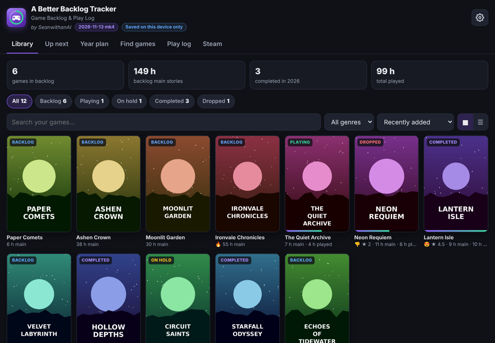
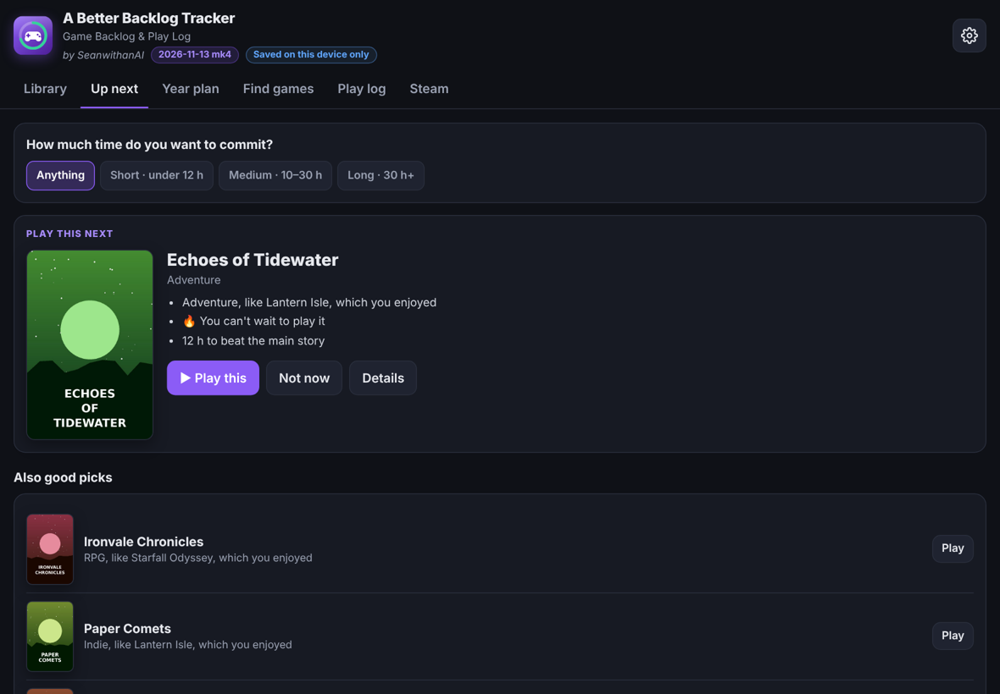
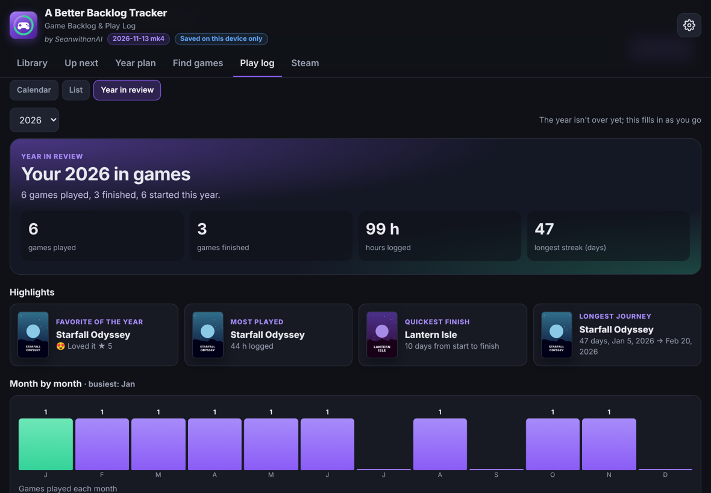
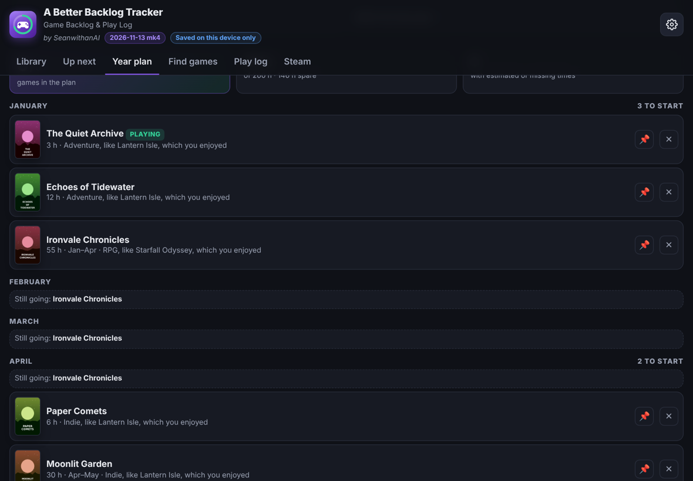

# A Better Backlog Tracker

**Game Backlog & Play Log: what to play next, how long it takes, and your year in games**

*by SeanwithanAI*

---

## Overview

A Better Backlog Tracker keeps your game backlog, your play log and your reviews in one place. It helps you decide what to play next, plans a year of games around the time you actually have, and wraps each year up with a recap. It's all in one HTML file, with nothing to install and no sign-up.

## Features

- **Find games before you add them.** Search the free **RAWG** game database and see screenshots, player ratings, Metacritic score, genres, platforms, developer and a description first.
- **Cover-art library.** Box-art tiles (Steam box art when available) with status, main-story time, hours played and a progress bar. Switch to detail cards any time. Filter by status or genre, and sort by rating, length, time played or excitement.
- **HowLongToBeat times.** Every game links to HowLongToBeat and keeps its main-story hours. Estimated times are marked **≈** until you confirm them.
- **How excited are you?** *🔥 Can't wait*, *✨ Interested* or *🌙 Someday*, each explained, so the backlog sorts itself.
- **Up next.** One clear pick for what to play next, plus backups, each with the reasons (*"Heavy on story, like Disco Elysium, which you enjoyed"*). Choose how long a game you want, from short to 30 h+. **Not now** hides a pick for 3 days.
- **It learns what you like.** After you finish a game, *How was it?* asks how you felt (😍 🙂 😐 👎), what worked (story, combat, music, challenge…), what didn't, and whether you want more like it. Every review changes the picks and the **Your taste so far** summary.
- **Other players' opinions.** RAWG player ratings (Exceptional → Skip), the critic score, recent posts from the game's subreddit, and links to Steam, Metacritic, RAWG and Backloggd reviews.
- **Year plan.** Set a goal (*finish 20 games*) and how many hours a week you can play. The plan fills the year month by month from your backlog. Mark a game **📌 must play** and the plan makes room, telling you what it moved out to stay within your hours. If the goal doesn't fit, it shows how many hours a week you'd need.
- **Play log with start and finish dates.** Log when you started and finished each game, with optional hours and notes. See a **calendar** of what you played each day, and a counter of games played and finished this year, with your goal.
- **Year in review.** Games played and finished, hours, longest streak, favorite, most played, quickest finish, longest journey, month by month, and every game's start-to-finish timeline. A banner announces it each December.
- **Import your backlog.** Paste a list of games, or import a game-list file (for example, a Backloggd backlog). Games you already have are skipped, and RAWG can fill in covers and ratings afterwards.
- **Steam (optional).** Pull in your Steam library and playtime with your own Steam Web API key.
- **Backup and restore,** with a reminder when you haven't backed up in a week (outside PageVault).

## Screenshots

| Up next | Year in review |
|---|---|
|  |  |

| Year plan |
|---|
|  |

Screenshots use made-up games and example data.

## Getting started

1. Open `A-Better-Backlog-Tracker-<date>-<mk>.html` in any modern browser, or open it from **PageVault**.
2. For game search, get a free API key at [rawg.io/apidocs](https://rawg.io/apidocs) and paste it in **Find games** (or **Settings**).
3. Add games from **Find games**, use **Import a list**, or import a game-list file from **Settings → Import backup**.
4. Mark how excited you are about each game, and check **Up next** when you can't decide.
5. When you start or finish a game, log it in **Play log** and answer *How was it?*

Online lookups (RAWG, Steam, cover images) use free public services. Everything else works offline.

## Where your data is stored

| Opened from… | Saved to | Badge shown under the app's name |
|---|---|---|
| **PageVault** | Your own server only, separately for each signed-in person. Nothing is kept in the browser. No backup reminders. | *Saved to your server* |
| **A local file** | This browser only. Use **Settings → Back up** to keep a copy; a reminder appears after 7 days without one. | *Saved on this device only* |

Backups include your API keys. Moving between the two: back up on one side and **Import backup** on the other.

## Versioning

Every release is a new file named with the release date. The first release of a day is just the date; later releases that same day add `mk1`, `mk2`, `mk3`… (the count starts over each day), e.g. `A-Better-Backlog-Tracker-2026-11-13.html`, then `A-Better-Backlog-Tracker-2026-11-13-mk1.html`. The version also appears under the app's name and in the footer. Older files stay in the repo, so PageVault can roll back to any of them.

| Version | Notes |
|---|---|
| **2026-11-13 mk4** | PageVault ready: *Saved to your server* / *Saved on this device only* badge, a 7-day backup reminder outside PageVault, and backup status in Settings. Fixed screenshots and header pictures that didn't load (they now use sizes RAWG actually serves, and fall back to the full-size image). |
| **2026-11-13 mk3** | Game-list imports keep estimated main-story times (marked ≈) and Backloggd links. The year plan fills your hours sensibly instead of choosing only the shortest games. |
| **2026-11-13 mk2** | Year plan with goals, hours per week and must-play games. Import a pasted list or a game-list file. Recommendations learn story and narrative preferences. Yearly goal on the play log. |
| **2026-11-13 mk1** | Play log with start and finish dates, calendar, Year in review, and excitement levels. |
| **2026-11-13** | *How was it?* reviews, other players' ratings and subreddit posts, and the Up next recommender. |
| **2026-11-12 mk1** | Cover-art tiles. |
| **2026-11-12** | First release. |

---

A Better Backlog Tracker · Game Backlog & Play Log · by SeanwithanAI · private repository

